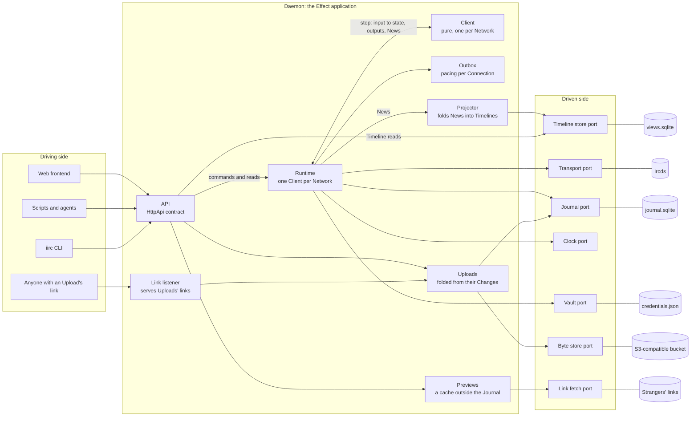
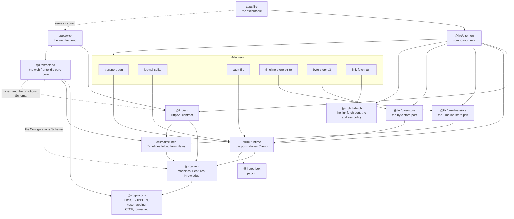

# Architecture

iirc is a pure IRC client inside an Effect application shaped as ports and adapters. This is how the pieces fit together, and why.

## The shape

- **The Client is a pure value.** It takes inputs, and gives back its next state, its outputs, and News. It has no ports, no Effect, no clock, no storage, and no sockets.
- **The Daemon around it is an Effect application.** A Runtime drives one Client per Network. The ports name the jobs the Daemon needs done: reach an Ircd, keep the Journal, hold Credentials, tell the time, keep the Timelines, keep bytes by their hash, and fetch a stranger's link. Layers supply the adapters.
- **History is the Journal.** It records every input and output in order, and everything else, including the Client's state, its timers, and News, is a projection of it, but for what a Preview fetched and the bytes of an Upload.
- **IRCv3 enters through Features at the edges.** A Feature refines what the core derived from a Line, so the model never asks whether a cap is on.
- **The RFC protocol is the floor.** Any RFC Ircd gets at least base support, and nothing core depends on a cap.

| Port | Its job | Production adapter | Test adapter |
| --- | --- | --- | --- |
| API (driving) | Take the Owner's commands and answer reads | `HttpApi` on Bun, in `@iirc/daemon` | the same handlers through an in-process client |
| Link listener (driving) | Serve each Upload at its link, and nothing else | `layerLinkListener` in `@iirc/daemon`, on Bun | the same, over a real server on a loopback port |
| Transport | Dial an Ircd, carry Lines both ways, and say how the Connection ended | `@iirc/transport-bun`: TCP and TLS | the memory Transport in `@iirc/runtime/testing` |
| Journal | Append durably, read back, and follow the tail | `@iirc/journal-sqlite` | the memory Journal |
| Vault | Hold Credentials, and give a value at the last moment | `@iirc/vault-file` | the memory Vault |
| Clock | Tell the time, and wait until a time | Effect's `Clock` | Effect's `TestClock` |
| Timeline store | Keep the Timelines folded from News, and answer windows, changes, and searches | `@iirc/timeline-store-sqlite` | the memory store in `@iirc/timeline-store/testing` |
| Byte store | Keep bytes by their hash | `@iirc/byte-store-s3`: an S3-compatible bucket, where the Uploads keep their bytes | the memory store in `@iirc/byte-store/testing` |
| Link fetch | Fetch a stranger's link, bounded, or refuse it | `@iirc/link-fetch-bun`: the guard, through which the Daemon fetches Previews | the fake in `@iirc/link-fetch/testing` |

Ports are named for the job, not the technology behind them. A port has laws that every adapter of it must pass, so a new adapter proves itself against the same tests as the fake: the Runtime's in `@iirc/runtime/testing`, the Timeline store's in `@iirc/timeline-store/testing`, and the byte store's in `@iirc/byte-store/testing`. The link fetch is the exception: its fake answers whatever it is told, so the guard proves itself against adversarial tests of its own.

## Packages

## Decisions waiting

- **`message-redaction`.** A redaction points at an earlier message id, which fits an append-only Journal. How a Timeline shows a redacted Message is still to decide.
