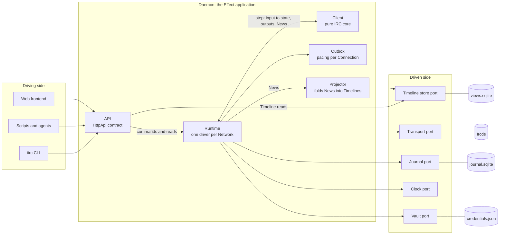
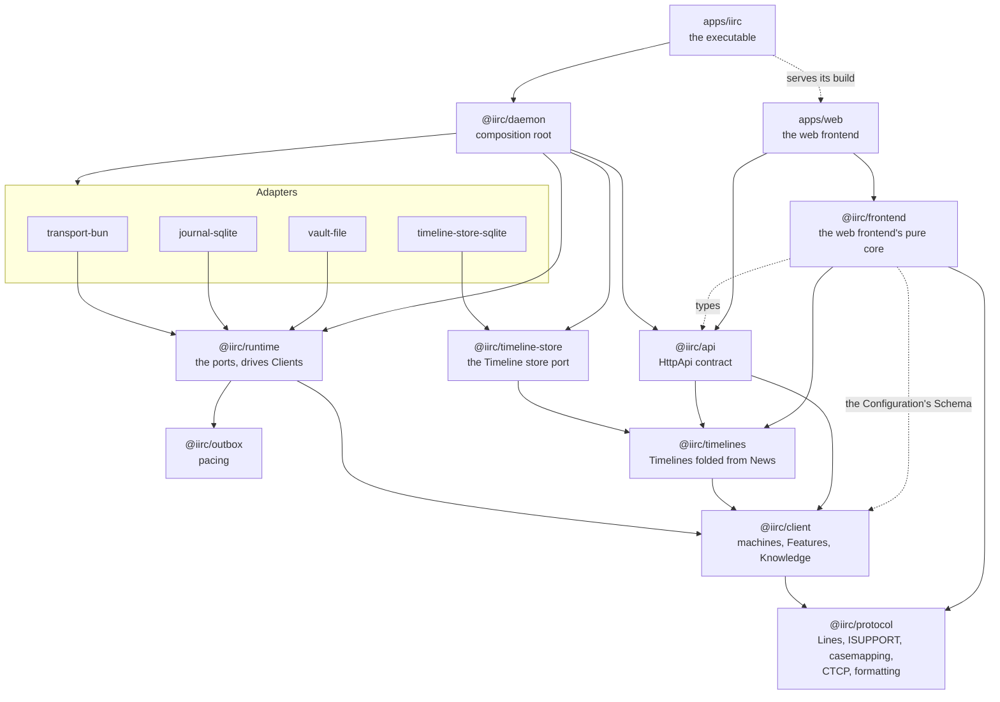
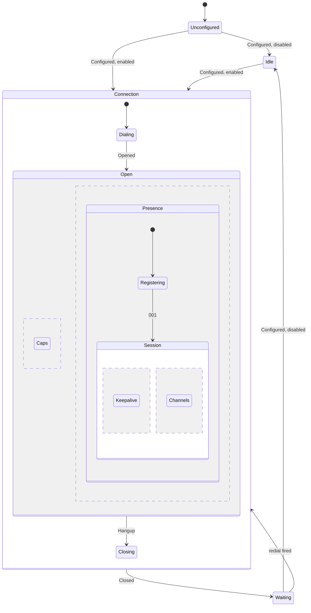
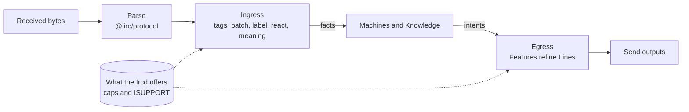
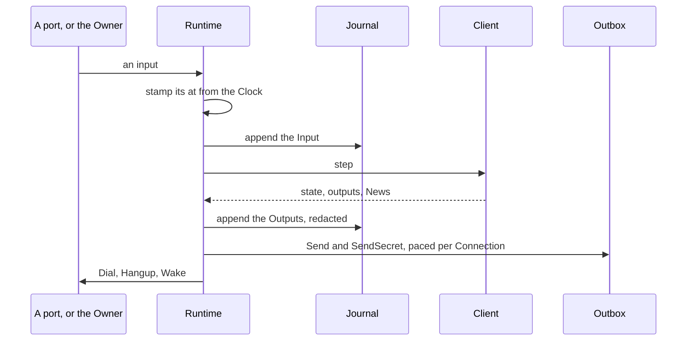

# Architecture

iirc is a pure IRC client inside an Effect application shaped as ports and adapters. This document is the map: how the pieces fit together, why, and where to add to them. Each module's README is its written interface and says exactly what it does. The [ADRs](adr/) record the decisions, and [`GLOSSARY.md`](../GLOSSARY.md) defines the words.

## The shape

- **The IRC client is a pure value.** It takes inputs, and gives back its next state, its outputs, and News. It has no ports, no Effect, no clock, no storage, and no sockets.
- **The Daemon around it is an Effect application.** A Runtime drives one Client per Network. Its ports name the jobs the Daemon needs done: reach an Ircd, keep the Journal, hold Credentials, and tell the time. Layers supply the adapters.
- **History is the Journal.** It records every input and output in order, and everything else, including the Client's state, its timers, and News, is a projection of it.
- **IRCv3 enters through Features at the edges.** A Feature refines what the core derived from a Line, so the model never asks whether a cap is on.
- **The RFC protocol is the floor.** Any RFC Ircd gets at least base support, and nothing core depends on a cap ([ADR 0001](adr/0001-the-rfc-protocol-is-the-floor.md)).



| Port | Its job | Production adapter | Test adapter |
| --- | --- | --- | --- |
| API (driving) | Take the Owner's commands and answer reads | `HttpApi` on Bun, in [`@iirc/daemon`](../packages/daemon/README.md) | the same handlers through an in-process client |
| Transport | Dial an Ircd, carry Lines both ways, and say how the Connection ended | [`@iirc/transport-bun`](../packages/transport-bun/README.md): TCP and TLS | the memory Transport in `@iirc/runtime/testing` |
| Journal | Append durably, read back, and follow the tail | [`@iirc/journal-sqlite`](../packages/journal-sqlite/README.md) | the memory Journal |
| Vault | Hold Credentials, and give a value at the last moment | [`@iirc/vault-file`](../packages/vault-file/README.md) | the memory Vault |
| Clock | Tell the time, and wait until a time | Effect's `Clock` | Effect's `TestClock` |
| Timeline store | Keep the Timelines folded from News, and answer windows and changes | [`@iirc/timeline-store-sqlite`](../packages/timeline-store-sqlite/README.md) | the memory store in `@iirc/timeline-store/testing` |

Ports are named for the job, not the technology behind them. Each port has laws that every adapter of it must pass, so a new adapter proves itself against the same tests as the fake: the Runtime's in `@iirc/runtime/testing`, and the Timeline store's in `@iirc/timeline-store/testing`.

## Packages



| Package | Pure | Its job |
| --- | --- | --- |
| [`@iirc/protocol`](../packages/protocol/README.md) | yes | The grammar of a Line and the protocol's vocabulary. A Line that cannot be sent safely cannot be built. |
| [`@iirc/client`](../packages/client/README.md) | yes | The IRC client for one Network: its machines, its Features, and what it knows. Also the transcript test kit. |
| [`@iirc/outbox`](../packages/outbox/README.md) | yes | Which Line leaves next, and when: a token bucket, with `PING` and `PONG` first. |
| [`@iirc/timelines`](../packages/timelines/README.md) | yes | Timelines as a fold over News: which Timeline each item goes to, its position, and the changes a store applies. |
| [`@iirc/timeline-store`](../packages/timeline-store/README.md) | no | The Timeline store port, its in-memory adapter, and the laws its adapters keep. |
| [`@iirc/runtime`](../packages/runtime/README.md) | no | The ports, and the Runtime that journals each input, steps the Client, and carries out its outputs. |
| [`@iirc/transport-bun`](../packages/transport-bun/README.md) | no | Sockets, TLS, and framing bytes into Lines. |
| [`@iirc/journal-sqlite`](../packages/journal-sqlite/README.md) | no | Durable appends, reads, and following, in SQLite. |
| [`@iirc/vault-file`](../packages/vault-file/README.md) | no | Credentials in a `0600` file, written atomically. |
| [`@iirc/timeline-store-sqlite`](../packages/timeline-store-sqlite/README.md) | no | The Timelines in SQLite, each step applied whole, made again from the Journal when it cannot be used. |
| [`@iirc/api`](../packages/api/README.md) | contract | The HTTP API every Frontend uses, as Schemas and typed errors. |
| [`@iirc/daemon`](../packages/daemon/README.md) | no | Wires the Layers together, implements the API, and serves it. |
| [`@iirc/frontend`](../packages/frontend/README.md) | yes | The web frontend's core: what it shows, as plain data and reducers, such as whether the browser is signed in, the Timelines it follows and how each item is drawn, the commands, the keymap, the palette, and the composer, what is unread, when marking read is due, and which items notify, and the options, derived from the Configuration's Schema. |
| [`apps/iirc`](../apps/iirc/README.md) | no | The `iirc` executable, whose arguments choose what it runs ([ADR 0007](adr/0007-one-binary-shapes-by-argument.md)). |
| [`apps/web`](../apps/web/README.md) | no | The web frontend: React over its core, reaching the Daemon only through the API ([ADR 0010](adr/0010-the-web-frontend-is-a-pure-core-under-react.md)). |

The lint fence in `oxlint.config.ts` keeps the dependencies pointing this way. The pure packages may not import Effect's services, Bun, Node, an adapter, or a test kit, the web frontend's core may not import React or reach the DOM, takes only types from `@iirc/api`, and of the Client only its Configuration's Schema, and the web frontend reaches the Daemon only through `@iirc/api`. [`AGENTS.md`](../AGENTS.md) states the rule the fence approximates.

## Inside the Client

```ts
interface Client<State> {
  readonly initial: State;
  readonly step: (state: State, input: Input) => Step<State>; // { state, outputs, news }
  readonly known: (state: State) => Knowledge;
  readonly channel: (state: State, name: string) => ChannelView | undefined; // one Channel alone
  readonly inspect: (state: State) => Inspection;
}
```

Every input carries `at`, the time it happened, so the Client never reads a clock. Inputs come from the Owner (`Configured`, `Say`, `Read`, `Retry`), the Transport (`Opened`, `Received`, `Closed`), the Clock (`Fired`), and the Runtime (`Started`, `Stopping`, `Unfilled`, `Unsent`). Outputs are `Dial`, `Send`, `SendSecret`, `Hangup`, and `Wake`. Configuration always arrives whole, so joining, parting, and quitting are changes to it, not commands.

**A Line counts as sent once the Client emits it,** unless an `Unsent` input later says it never left. The Client never waits on a write.

**A Credential travels as a name.** `SendSecret` names one, the Runtime fills in its value at the last moment, and the Journal records the Line without it ([ADR 0008](adr/0008-credentials-are-held-not-hunted.md)). The Client never sees a Credential's value.

### Machines

From outside, a Network is one machine. Inside, it is a statechart of small ones, each a plain reducer over a discriminated union ([ADR 0009](adr/0009-client-machines-are-reducers.md)):



- **Network** outlasts everything: the Channels wanted, the backoff, which Ircd is next, and the STS policies.
- **Caps** runs beside Presence for the whole Connection, because `cap-notify` can add or remove caps mid-Session. It holds registration open until `CAP END`, so SASL logs in before the Session begins.
- **Session** runs from `001` to the Connection's end, with the keepalive and one machine per Channel side by side.
- **One backoff** serves every wait: redialling a Network and rejoining a Channel.

`inspect` names each machine's state with the statecharts' dotted names, such as `Ready.Steady` or `Joined.Synced`, and the [Client's README](../packages/client/README.md#inspection) lists them.

### Features

Caps come in almost any combination, and can change mid-Session. If the machines asked "is `multi-prefix` on?", the combinations would multiply through all of them. Instead, caps meet the Client at two edges:



A Feature is one module for one cap or ISUPPORT token, or a tight group of them. It declares the caps it `needs` and `uses`, the facts it `keeps`, and hooks for the stages it refines. The core decides when it is on, and when it turns off, the core marks the facts it kept as stale, so no Feature handles `CAP DEL` itself. Ingress runs in a fixed order, so a labelled reply inside a batch, with `server-time` on each Line, composes without special cases.

Knowledge reads facts, never caps. Each fact is `Known`, `Partial` (only for sets), `Stale`, or `Unknown`, and says whether the Ircd pushed it, replied with it, it was inferred from receipt, or we set it. A new Feature changes which case a fact lands in, not the code that reads it.

The Client has these Features today, in the order of `src/registry.ts`: `cap-notify`, `sasl` (PLAIN), `message-tags`, `server-time`, `batch`, `echo-message` with `labeled-response`, `multi-prefix`, `away-notify`, and `UTF8ONLY`. STS is in the core rather than a Feature, because its policy outlives Connections and decides where to dial before any cap is negotiated.

### Without a cap

Starting from the caps, a cap's absence means less information, not a job to do by hand. The behaviour without a cap falls into three kinds:

| Kind | What we do | Examples |
| --- | --- | --- |
| **The base protocol gives it, less precisely** | Build it as ordinary parsing, and the fact says how precise it is | `NAMES` shows only the highest prefix, so prefixes are `Partial`. A Message's time is when it arrived. |
| **The cap's absence leaves a hole in correctness** | Build it, because without it we are wrong | Without `echo-message`, our own Messages are recorded from our outputs. |
| **Recovering the fact needs polling or guessing** | Leave it out until judged worth its cost, and the fact stays `Unknown` | `WHO` polling for away status. Re-reading `NAMES` after a mode change. Identifying to NickServ by reading its replies. |

The Journal makes polling dearer for iirc than for most IRC clients: every reply is recorded and replayed for as long as history is kept, and a guess recorded as fact can't be taken back.

## Time

**If it reads or writes Lines, it belongs to the Client. If it is about bytes or sockets, it belongs to an adapter.** Time crosses into the Client only as data: a `Wake` output sets a timer, and a `Fired` input says it is due. A timer's instant is worked out from the `at` of the input that asked for it, so a replay asks for the same timers at the same instants.

| Timer | Held by | Why |
| --- | --- | --- |
| Redial, registration, the hold for SASL, keepalive, rejoin | Client | They decide which Lines to send, judged from the Lines heard |
| Pacing | Outbox | It applies to Lines in flight, not to what they mean |
| Connect, TLS handshake, a stalled write, a hang-up | Transport | They are about sockets. Each ends as `Closed` with a reason |
| Stopping the Daemon | Runtime | It bounds how long shutdown waits on Ircds |

The State holds no timer table. Each machine's state names the instants it waits for, and the table is derived from them.

## The Runtime and the Journal

Each input is recorded first, then stepped:



- **Restart is replay.** The Runtime folds each Network's Inputs from `initial` to rebuild its state and its timer table, never carries out a past step's outputs again, and steps `Started` so the Client knows any Connection it believed open is gone.
- **News is derived.** It is never journaled. A reader folds the Journal from the start and resumes after a sequence, so a Frontend that reconnects misses nothing.
- **Timelines are derived from News.** The Daemon's projector is one such reader: it folds each step into the Timeline store, `views.sqlite`, with the last sequence folded, and resumes after it on start. It never holds up the Runtime, and a store of another projection version, or none, is folded again from the start ([ADR 0011](adr/0011-timelines-are-a-projection-the-client-routes.md)).
- **Outputs are the record of what we did.** Without `echo-message`, the output that sent a Message is the only record that we said it.
- **The Journal is versioned and not frozen.** A Daemon that finds a Journal of another version refuses it. There are no migrations until the shape settles.
- **Shutdown is graceful and bounded.** `Stopping` makes every Client say `QUIT` on its Connection, the Runtime waits up to `stopTimeout` for the Ircds, and then closes what is left.

## The Daemon and its API

`iirc daemon --data-dir <dir>` holds the data directory exclusively, opens the Journal, the Vault, and the Timeline store in it, starts the Runtime with the real Client and the projector beside it, and serves [`@iirc/api`](../packages/api/README.md) on loopback. Every route is under `/api` and needs a bearer key, made with `iirc key create`, or a sign-in, which a browser gets for its key once and holds in an `HttpOnly` cookie. A Frontend drives the Daemon through `HttpApiClient.make(DaemonApi)` or plain HTTP, and follows News as Server-Sent Events. It reads Timelines rather than folding News: a Network's Timelines a page at a time, a window of one, and the items a step made, each with the projection version and the last step folded into what it read, and then the changes from that place as Server-Sent Events, which wait on the projector rather than poll the store, hold a bounded number of things each, and reset a place a new projection version cannot resume. For a Channel's Timeline, it also reads the Channel's head and its members a page at a time, as the Client knows them now, from that Channel alone rather than all the Network knows. Everything the Daemon knows, apart from Credentials, can be read through the API: `known` for Knowledge, and `inspect` for machine states, caps, timers, and each Connection's queue. A Frontend reads a Network's Configuration with the sequence of the `Configured` that set it, changes one option, and sends the whole of it back naming that sequence, which the Network's own turn checks, so two Frontends editing at once cannot overwrite each other ([ADR 0013](adr/0013-configuration-is-an-option-tree.md)).

`iirc daemon --web` also serves the web frontend on the API's own origin: the build compiled into the executable, or with `--web=<dir>`, one built into a directory. Its routes are a Layer that only `apps/iirc` knows, which the Daemon serves beside the API without knowing what it is, and nothing under `/api` ever reaches them.

## Testing

- **The everyday suite opens no socket to an Ircd.** `bun run test` runs every package's tests in one Vitest run, with each package a project in the root `vitest.config.ts`, so one worker pool serves them all. A package's own `bun run test` runs just its tests.
- **Client scenarios are transcripts of IRC.** The [test kit](../packages/client/src/testing/README.md) plays a transcript through the Client on a fake clock, matches every Line it sends, and fails with a transcript diff. After every scenario it replays the whole Journal and checks the result is the same, and that State is plain data.
- **Four laws hold across caps.** For every set of caps the kit's `across` gives, a Feature that is off changes nothing, more caps only sharpen facts, replay is exact, and after `CAP DEL` behaviour matches never having had the cap.
- **Recorded Ircds replay in the suite.** The [fixtures](../fixtures/transcripts/README.md) are real Sessions on Ergo and ngircd, and the Client must follow each with nothing ignored.
- **Each port has laws** that its memory adapter and its production adapter both pass.
- **End-to-end runs are deliberate.** `bun run e2e` drives a real Daemon through its API against a private ngircd and Ergo on loopback ports, covering the floor, a restart, pacing, a graceful `QUIT`, and SASL over TLS. It then drives the web frontend in Chromium on a real `iirc daemon --web`, signing in, reloading, and signing out, and reading a Channel's Timeline on a private ngircd: live, formatted, and older on scrolling up, and saying Messages from the composer there, to the Channel, as an action, and to a nick, opening the palette with the keyboard to jump to the Channel and run commands, and moving between Timelines with keys, showing a Highlight in two Frontends' sidebars and titles, notifying of it, jumping to it with Alt+A past a "new" divider, and seeing both clear once it is marked read, and, from a Daemon with no Network, adding one, joining and parting a Channel, and changing options in place.

## Extending it

- **A new Feature** is a module in `packages/client/src/features/`, added to the registry in `src/registry.ts`, with scenarios in `src/scenarios/` that play through `step`. The laws pick it up from the registry. Its entry in the Client's README says what it needs, what it changes, and where its scenarios are. A Feature exists when its scenarios pass.
- **A new adapter** implements a port from `@iirc/runtime` or `@iirc/timeline-store` and passes that port's laws.
- **A new API route** is added to the contract in `@iirc/api` first, with its Schemas and errors, then handled in `@iirc/daemon`.
- **A new Ircd behaviour** is handled from the protocol's structure: commands, numerics, parameters, and tags. Nothing is decided from an Ircd's free text, and Ergo and ngircd are examples of what the protocol allows, not the cases to code for.

Each README ends with what that module does not do yet. Beyond those, these IRCv3 specs are the next candidates:

| Cap or token | What it refines |
| --- | --- |
| `chathistory` | Fills a Gap with History, arriving late with `live` false. The types already carry it. |
| `account-notify`, `extended-join`, `account-tag` | A User's account |
| `chghost`, `userhost-in-names` | A User's mask |
| `setname` | A User's realname |
| `standard-replies` | `FAIL`, `WARN`, and `NOTE` with codes to decide from |
| `invite-notify` | An `Invited` Activity |
| `bot-mode` (`BOT`) | Whether a User is a bot |
| `MONITOR`, `extended-monitor` | Whether a Direct Message partner is online, pushed rather than polled |
| `WHOX` | Richer `WHO` replies, with accounts, once on joining |
| `netsplit` and `netjoin` batches | A mass quit shown as one Activity |
| `draft/multiline` | Long Messages, both ways |
| `draft/pre-away`, `draft/read-marker`, `draft/extended-isupport` | Away before registration, a shared Read Marker, and ISUPPORT before registration |

Some would change types, and need a decision first:

- **SASL `SCRAM-SHA-256` and `EXTERNAL`.** SCRAM's replies depend on the Ircd's challenge, so it lands in `SecretLine` or on the Runtime's side. EXTERNAL logs in with a client certificate, which `Dial` would name as a Credential.
- **`message-redaction` and `channel-rename`.** A redaction points at an earlier message id, which fits an append-only Journal. A rename means a Timeline cannot be keyed by a Channel's name, so both matter before Views choose their keys.
- **`TAGMSG` and client tags such as `typing`.** `typing` can arrive every 3 seconds per Target, and every received Line is journaled, so decide how the Journal holds it before turning it on.
