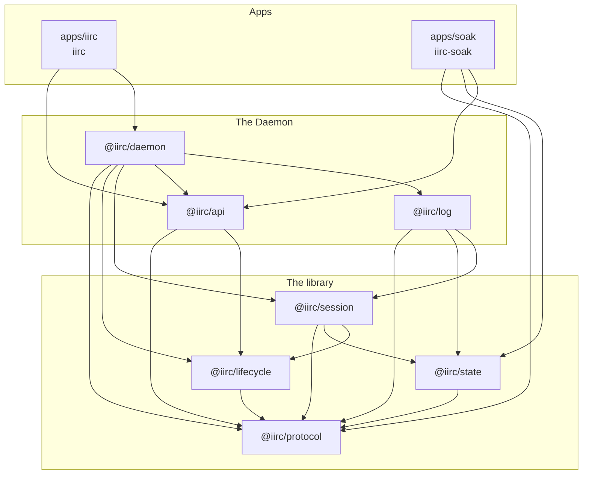
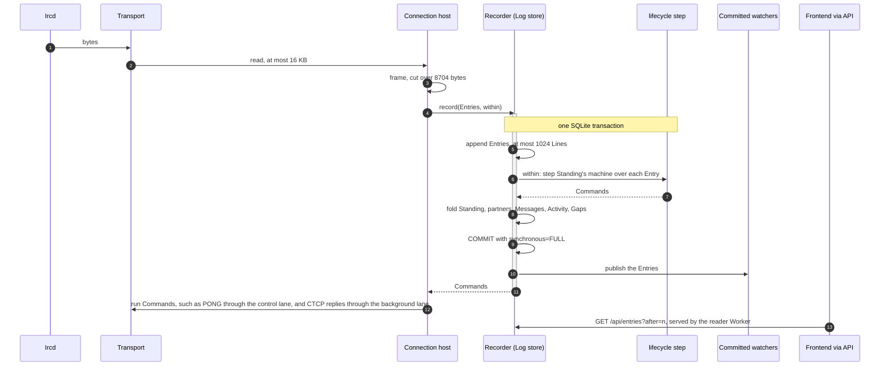
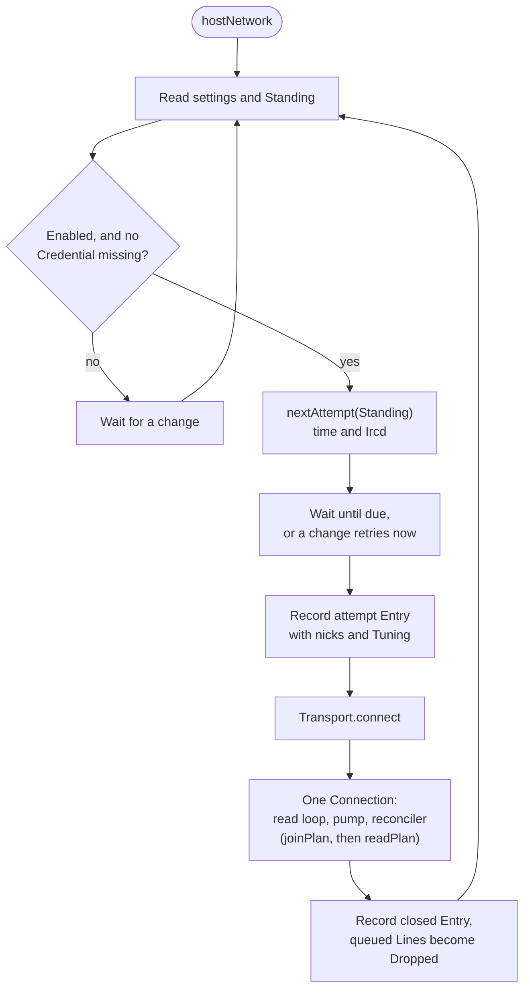
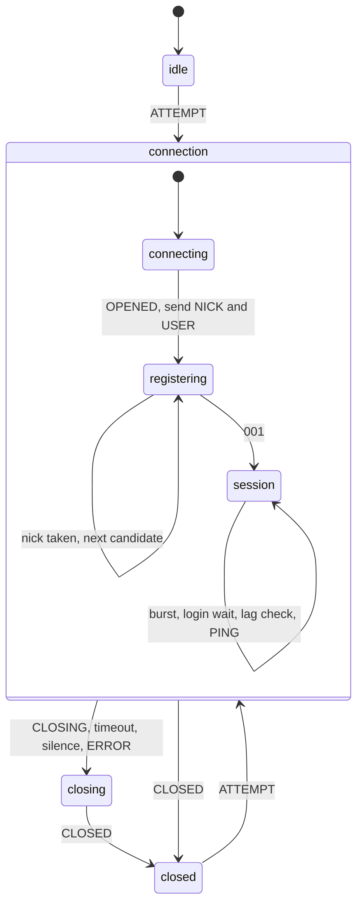
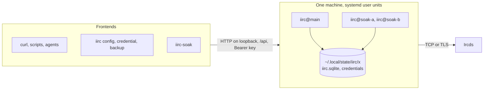

# Architecture

A high-level map of the codebase: the packages, how a Line moves through them, and where the seams are. [`requirements.md`](requirements.md) says what the Daemon must do. Each package's README has the detail and the traps.

Versions: Bun 1.4.4 and Effect 4.1.1, pinned in the root `package.json` catalog.

## The idea

- **One Log, everything else derived.** Every durable fact is an Entry. Configuration, Network state, Messages, Gaps, and a Network's lifecycle are folds over Entries ([ADR 0002](adr/0002-the-log-holds-bytes.md), [ADR 0003](adr/0003-machines-are-projections.md), [ADR 0004](adr/0004-configuration-lives-in-the-log.md)).
- **Record, then act.** Nothing acts on a Line before it is committed (LOG-4). A machine steps inside the append transaction, and its Commands run after commit.
- **The Daemon is a composition of packages.** The library at the bottom knows nothing of SQLite, HTTP, or Configuration. The Daemon adds durability, Configuration, and the API.
- **Who owns what:**

| Owner | Owns | Examples |
| --- | --- | --- |
| Pure code | Anything that can be computed, including phases that gate behaviour | Parsing, decoding, folds, the Network machine, `Standing`, `nextAttempt`, `joinPlan`, `readPlan`, `ctcpAnswer`, the token bucket |
| Effect | Anything that waits, fails, or holds a resource | Hosts, lanes, the Log, the reader Worker, the API, the CLI |
| Bun | The runtime and build; what Effect does not offer ([ADR 0005](adr/0005-effect-wins-where-it-overlaps-bun.md)) | The executable, SQLite, the keyring, the HTTP engine |

## Packages

Dependencies point down only. Each library package stands alone for whoever wants it. The jesopo lineage maps onto it: `protocol` is irctokens, `state` is ircstates, and `session` is ircrobots.

| Package | Job | Runtime dependencies |
| --- | --- | --- |
| [`@iirc/protocol`](../packages/protocol/README.md) | Bytes to Lines and back, safely: frames, parsing, decoding, formatting, CTCP, standard replies, outbound construction, nick candidates, `JOIN` batches, the token bucket | None |
| [`@iirc/state`](../packages/state/README.md) | What an Ircd's Lines mean for one Session: Self, the Channels Self is in with their topics, modes, and members, the Users seen, `RPL_ISUPPORT`, casefolding, and where each Line belongs | `protocol` |
| [`@iirc/lifecycle`](../packages/lifecycle/README.md) | The Network machine as a pure fold, and `Tuning` | `protocol` |
| [`@iirc/session`](../packages/session/README.md) | Hosts one Network: Transport, lanes, `Standing`, reconnect, rejoin, `Recorder`, `Committed` | `protocol`, `state`, `lifecycle`, `effect` |
| [`@iirc/log`](../packages/log/README.md) | The durable Log in SQLite: the writer, the reader Worker, derived tables of Messages, Activity, and Gaps, migrations, backup, the lock | `session`, `state`, `protocol`, `effect`, `@effect/sql-sqlite-bun`, `@effect/platform-bun` |
| [`@iirc/api`](../packages/api/README.md) | The contract: `DaemonApi`, Schemas, typed errors, scopes | `protocol`, `lifecycle`, `effect` |
| [`@iirc/daemon`](../packages/daemon/README.md) | Configuration, Credentials, keys, Network supervision, operations, and the API's handlers | `log`, `api`, `session`, `lifecycle`, `protocol`, `effect`, `@effect/platform-bun` |
| [`apps/iirc`](../apps/iirc/README.md) | The executable: argv, the HTTP server, and the CLI Frontends | `daemon`, `api`, `effect`, `@effect/platform-bun` |
| [`apps/soak`](../apps/soak/README.md) | `iirc-soak`, the soak test's Frontend (PROOF-5) | `api`, `state`, `protocol`, `effect`, `@effect/platform-bun` |

`@iirc/client` and `@iirc/web` do not exist yet. They arrive with the web frontend in milestone 4 ([roadmap](roadmap.md#milestones)).

## A Line's path

An inbound Line, from the socket to a Frontend. An outbound Line takes the same commit, just before its write.

- **Append first.** A crash can leave a Line recorded but unsent, never sent but unrecorded (LOG-4).
- **Commands are data.** Replay discards them, because their outcomes are already Entries.
- **A Connection's bytes decode as its `attempt` says.** The `attempt` records the whole Tuning, its fallback encoding included, so `Standing`, the machine, the derived tables, and `/entries` all decode a Line with UTF-8, then that fallback, then Latin-1 (MSG-4). A rebuild reads each Connection as live did, whatever the Owner changed since.
- **Each Line is placed as it is folded.** `@iirc/state/place` gives it the Network's Timeline, a Channel's, or a Direct Message partner's (MSG-2), and the fold writes it as a Message, as Activity, or as a `line` or `unknown` on the Network's Timeline, so nothing a Network sends is invisible (MSG-5, MSG-6, PROT-1). A `QUIT` or `NICK` is a row in each Channel it shared and each partner's Timeline (KNOW-8). The partners are carried beside the Standings, and a startup rebuilds both in the same pass.
- **Watchers never hold up a commit.** One that falls behind gets an `Overflowed` naming what it missed (HOST-5).
- **Reads never hold up an append.** Frontend reads run in a Worker on a read-only connection (LOG-11).

Requirements: [The Log](requirements.md#the-log), [Hostile input](requirements.md#hostile-input).

## The Network host

`hostNetwork` in `@iirc/session` stays on one Network for as long as its Scope lasts. It owns no state of its own: it reads its settings and `Standing` whenever it decides something.

One machine runs per Connection. Every `attempt` resets it. It holds no timers: deadlines are absolute times in its context, and the host records a Deadline Entry when one passes.

- **The machine owns a Connection's progress:** registration, nick fallback, giving up, the burst, and the login wait (CONN-2 to CONN-7, LIVE-1 to LIVE-3, LIVE-5).
- **`Standing` owns what outlasts a Connection, and what Self asked:** recent outcomes, kicks, `JOIN` failures, the `JOIN`s and reads asked on this Session and their replies, lag, and Gaps. It is a pure fold that both Recorders update in the same transaction. What Self asked is folded from Self's own outbound Lines, apart from `@iirc/state`, which only an Ircd moves (CONN-3).
- **Pure functions of `Standing` decide:** `nextAttempt` gives backoff and Ircd rotation (LIVE-4), `joinPlan` gives what to rejoin (LIVE-7, LIVE-8), `readPlan` gives which `MODE`, `NAMES`, and `WHO` to send (KNOW-5, KNOW-6), and `ctcpAnswer` gives whether to answer a CTCP request and with what (PROT-3, PROT-4). A plan's waits, such as a debounced `NAMES`, are absolute times derived from Standing, and the Line sent when one passes is its record, so they need no Deadline Entry of their own.
- **One reconciler carries out both plans,** joins first, one Line at a time through the background lane, so a read never delays a Message or a `PONG` (SEND-1). It holds no plan, and a commit wakes it only when `joinPlanMoved` or `readPlanMoved` says its inputs moved.
- **CTCP replies are decided in the fold and sent after the commit.** `Standing` counts each reply from when it decides it, and while it is pending, then from when it is recorded as sent, or not at all once Dropped, with any other CTCP `NOTICE` Self sends once recorded, in a window that outlasts every Connection, so neither a flood faster than the lane nor a restart gets past a limit (HOST-3). The commit reads what was decided in the same unit, and the host offers it to the background lane without waiting, so a reply never delays a Message. One still queued a window after it was decided is Dropped at the head of the lane, so a held-up lane cannot release a burst. A reply goes only to a sender's nick parsed as a User, never a Channel or a mask.
- **The Owner can force a casemapping.** An `attempt` that records one starts each Session's `IrcState` from `sessionState({ casemapping })`, and placement, partners, and planning all compare under `casemappingOf` (KNOW-3).
- **A host cannot stay dead.** A defect or a failed `record` ends the Connection and backs off like any failure (LOG-9).

Requirements: [Connecting](requirements.md#connecting), [Staying connected](requirements.md#staying-connected), [Sending](requirements.md#sending).

## Configuration and the Daemon

- **Configuration is a fold over Change Entries,** in `@iirc/daemon`. `session` stores a Change's payload as JSON it never reads.
- **One permit for Changes.** An operation checks itself against current Configuration, records its Change, and folds the recorded Entry, under one permit.
- **Nothing pushes settings.** Each host reads a `settings` effect and is woken by a `changes` Stream. A library user passes a constant.
- **One host per Network,** in a `FiberMap` keyed by Network ID. Disabled is a setting, not a missing host.
- **Keys are a second fold over the same Changes:** name, scope, and SHA-256.
- **Credentials live outside the Log,** behind one service over the keyring or a `0600` file ([ADR 0006](adr/0006-proportionate-security.md)).

Requirements: [Configuration](requirements.md#configuration), [Credentials](requirements.md#credentials), [Access](requirements.md#access).

## Seams

| Seam | Where | What it hides | What a test or library user puts there |
| --- | --- | --- | --- |
| `Transport` | `session` | Dialing TCP or TLS, pinning, reading with backpressure | `fakeIrcd()` or `scriptedIrcd()` from `@iirc/session/testing` |
| `Recorder` | `session`, `log` | How Entries are stored, and `Standing` | `Recorder.memory` |
| `Committed` | `session`, `log` | Watching Entries as they commit | Any Stream consumer, such as a bot |
| `NetworkOptions` | `session` | Where a host's settings come from | `constantNetwork(id, settings)` |
| `Log`, `LogReader` | `log` | SQLite, the writer, the reader Worker | A temporary data directory |
| `Credentials` | `daemon` | Keyring or file | A stand-in `Keyring` |
| `DaemonCore` | `daemon` | The whole Daemon, with no HTTP and no argv | A `Transport` and a `Keyring` |
| `DaemonApi` | `api` | The contract every Frontend uses | `HttpApiClient` |

## Composition and stopping

`apps/iirc` is the only place that reads argv. It builds `Daemon.stopsFirst`, on `HttpRouter.serve(ApiRoutes)` over `BunHttpServer`, on `DaemonCore`.

- **Stopping goes in this order:** every Network says `QUIT` (LIVE-9), then the `stopped` Entry, then the HTTP server, then the Log (RUN-3).
- **`SIGINT` and `SIGTERM` interrupt main,** so `QUIT` is a finalizer, and the process exits 0.
- **Shared Layers sit outside `HttpRouter.serve`,** which forks the MemoMap and would build the Log twice.

[`@iirc/daemon`](../packages/daemon/README.md#composition) has the reasons.

## Deployment

- **One executable, shapes chosen by argument** ([ADR 0007](adr/0007-one-binary-shapes-by-argument.md)). Only `iirc daemon` exists so far.
- **One Daemon per instance** of the `iirc@.service` template, each with its own data directory, Log, and port (RUN-1).
- **Remote access** goes through a tailnet or a reverse proxy (AUTH-5).
- [The running guide](guides/running.md) installs one. [The soak guide](guides/soak.md) runs two.

## Further reading

- [`requirements.md`](requirements.md): every requirement and its status.
- [`roadmap.md`](roadmap.md): milestones, the soak test, IRCv3, risks, and what is unproven.
- [`adr/`](adr/): the decisions that shape all of this.
