# Architecture proposal: a pure Client inside a hexagon

Status: proposal, 2026-11-07, revised 2026-11-08 after a first review. It decides nothing until we turn parts of it into ADRs. The [state machine survey](2026-11-07-state-machine-survey.md) is the starting point.

## Decided so far (2026-11-08)

- **The Journal records inputs and outputs.** Without `echo-message`, the only record of what we said is the output that said it. The Journal carries a version number from the start, and we change it, breaking, whenever the shape needs to. Nothing is frozen.
- **No soak test in the short term.** soak-1 started too early and pushed the design toward a frozen format.
- **Real Ircds are for end-to-end tests,** run on purpose and not in the everyday suite (§9).
- **IRCv3 is in the design now,** with a first set of Features chosen to exercise the extension mechanism (§3, "The first Features").
- **Features under modules replace requirements.** Each module grows by progressive enhancement from its floor (§10). The central requirements list and roadmap are gone.
- **Milestone 2's code is not an interface to stay compatible with.** It is salvaged only by deliberate porting (§11).

## In brief

- **The IRC client is a pure value.** It takes inputs and gives back its next state and outputs. It has no ports, no Effect, no clock, no storage, and no sockets.
- **Around it, the Daemon is an Effect application shaped as ports and adapters.** A Runtime drives one Client per Network. The ports name jobs the Daemon needs done: reach an Ircd, keep the Journal, hold Credentials, tell the time. Layers supply the adapters.
- **History is the Journal of the Client's inputs.** Every view is a projection of it, as now. Its format stays open until the shape settles.
- **Control flow is statecharts, and data is reducers.** We use XState 5's pure `transition` for states. We use plain functions for members, modes, and the like.
- **IRCv3 enters through Features at the edges.** A Feature translates Lines into facts, and intents into Lines, so the model never asks whether a cap is on.
- **The RFC protocol is the floor.** Any RFC Ircd gets at least base support, and no core behaviour depends on a cap. Features beyond that are added when judged worthwhile, which is a high bar for anything that needs polling.

## 1. The system as a hexagon

Ports and adapters is the right way to see the whole system, with one refinement. The hexagon is the Effect application. The Client sits inside it and has no ports of its own, because a pure function needs none. Ports start where the Runtime meets the world.

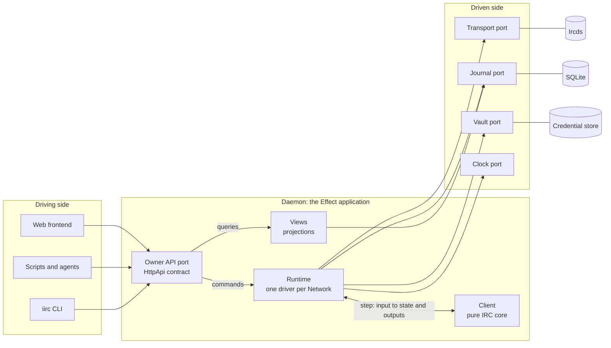

| Port | Its job | Live adapter | Test adapter |
| --- | --- | --- | --- |
| Owner API (driving) | Take the Owner's commands and queries | `HttpApi` on Bun, later RPC or SSE | in-process client |
| Transport | Dial an Ircd, carry Lines both ways, say how it ended | Bun TCP and TLS | scripted transcript, in-memory pair |
| Journal | Append inputs durably, replay them, follow the tail | SQLite | in memory |
| Vault | Hold Credentials, give a value at the last moment | file store | in memory |
| Clock | Tell the time, and wake at a time | Effect's `Clock` | Effect's `TestClock` |

Two rules come from Rat Stack:

- **Ports are shaped by jobs.** Each is named for what the Daemon needs, not for the technology behind it.
- **A lint fence keeps adapters out.** The Client and the Runtime may not import an adapter, which is what Rat Stack's `no-core-adapters` boundaries rule enforces.

## 2. Modules and how they depend on each other

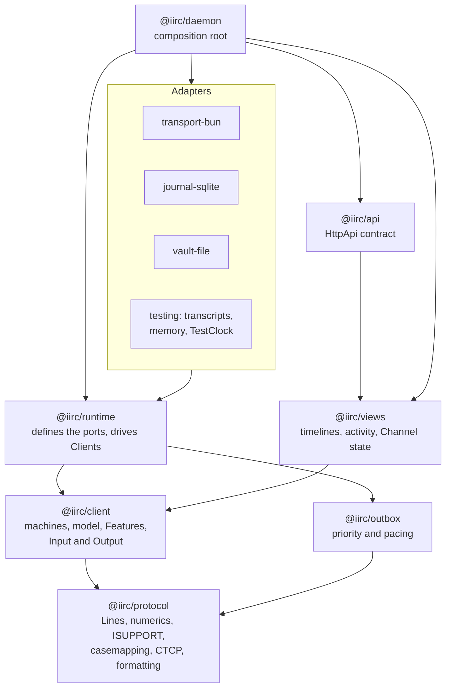

| Module | Pure | Its job | What it takes over from today |
| --- | --- | --- | --- |
| `@iirc/protocol` | yes | The grammar of a Line, and the protocol's vocabulary | `protocol`, plus casemapping and ISUPPORT from `state` |
| `@iirc/client` | yes | The IRC client: machines, model, and Features | `lifecycle`, `state`, and from `session`: `standing`, `reads`, `ctcp`, `events` |
| `@iirc/outbox` | yes | Which Line goes next, and when: priority, pacing, expiry | the queueing part of `lanes`, and `protocol/flood` |
| `@iirc/runtime` | no | Journal each input, step the Client, carry out its outputs | `network`, `connection`, `reconcile`, `recorder` |
| `@iirc/views` | yes, plus queries | Projections a Frontend reads | `log/derive`, `partners`, `formatted`, `daemon/views` |
| `transport-bun` | no | Sockets, TLS, splitting bytes into Lines | `transport`, `receive` |
| `journal-sqlite` | no | Durable appends, replay, the read Worker | `log/store`, `database`, `reader` |
| `vault-file` | no | Credential storage | `daemon/credentials` |
| `@iirc/api` | contract | The Owner's API | `api` |
| `@iirc/daemon` | no | Wire Layers together, serve HTTP | `daemon` |

## 3. Inside the Client

### Its shape

```ts
initial(config): State
step(state, input): { state; outputs }
```

Every input carries `at`, the time it happened. The Client never reads a clock.

| Inputs                                      | From                                        |
| ------------------------------------------- | ------------------------------------------- |
| `Configure`, `Say`, `Ask`, `Leave`, `Retry` | the Owner, through the Runtime              |
| `Opened`, `Received`, `Closed`              | the Transport                               |
| `Fired`                                     | the Clock, for a timer the Client asked for |

| Outputs                     | Carried out by               |
| --------------------------- | ---------------------------- |
| `Dial`, `Send`, `Hangup`    | the Outbox and the Transport |
| `StartTimer`, `CancelTimer` | the Clock                    |

A `Send` may name a Credential. The Runtime fills in the value from the Vault on the way out, and the Journal records the Line redacted. The Client never sees a Credential's value.

**A Line counts as sent once the Client emits it.** TCP keeps Lines in order. If the Connection dies first, the Session's state goes with it. So the Client never waits to hear whether a write landed.

### Many small machines, one large one

From outside, a Network is one machine. Inside, it is a statechart of small ones.

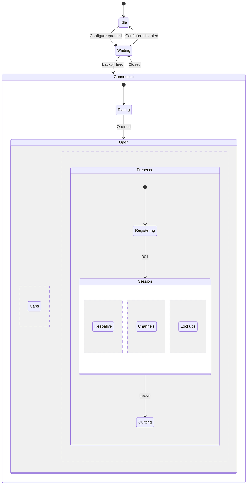

- **Network** outlasts everything. It holds the Channels wanted, the backoff, which Ircd is next, and kicks and refusals that outlast a Session.
- **Connection** lasts one transport. Its states are the only record of a Connection closing. Today that is spread over the machine's `closing`, the host's `Draining`, and the lane gate.
- **Caps** runs beside Presence for the whole Connection, not only during registration, because `cap-notify` can add or remove caps mid-Session. It holds registration open until `CAP END`.
- **Presence** offers nicks while Registering. Login is SASL inside Caps, so there is no login wait after `001`.
- **Session** runs from `001` to the end. It holds these regions side by side:
  - Keepalive
  - one machine per Channel
  - Lookups in flight

### Cap negotiation

Cap negotiation is the most machine-like part of IRCv3, and the one every Feature depends on:

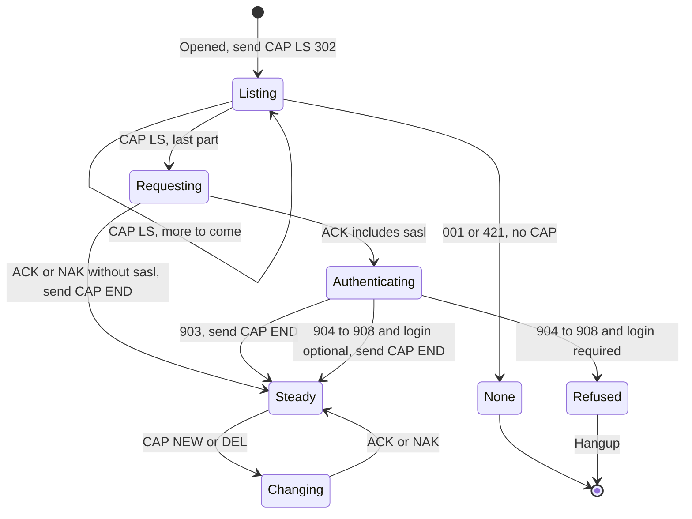

- **None** is an Ircd with no cap negotiation. It ignored `CAP`, or answered `421`, and registration went ahead on `NICK` and `USER`. The Feature set is empty.
- **Whether login is required is Configuration.** Libera, for example, needs SASL from some address ranges. A Network can say to Hang up rather than join Channels unauthenticated. That decision rests on numerics, never on text.
- **The negotiated set is a fact the Features read.** Together with ISUPPORT, it is "what this Ircd offers".

A Channel's machine replaces the four to six maps and flags that join and read state are spread over today:

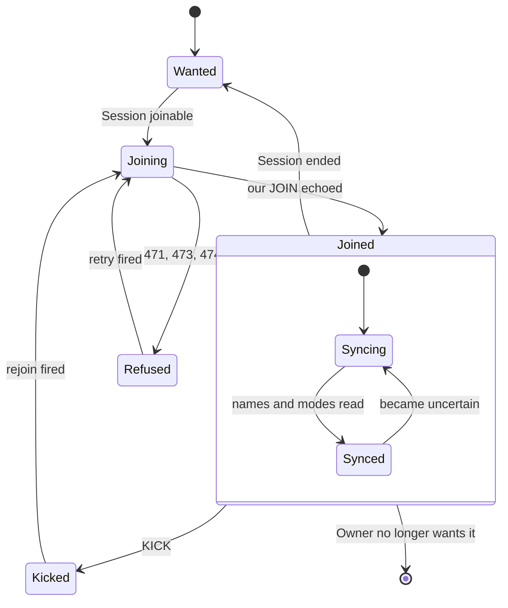

There is **one backoff**: a single function that the Network, Channel, and Lookup machines all call for their retry delay. Today four kinds of state each hold a backoff of their own.

### Features: how IRCv3 enters without branching the model

Caps can come in almost any combination, and `cap-notify` can change them mid-Session. If the machines asked "is `multi-prefix` on?", the combinations would multiply through every one of them. Instead, caps meet the Client at two edges:

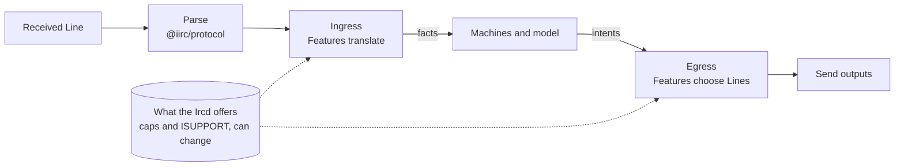

A **Feature** is one module for one cap or ISUPPORT token, or a closely tied group. Not everything that changes the protocol is a cap: `UTF8ONLY` is an ISUPPORT token, so Features key on both. A Feature declares:

- **requests:** the caps it asks for, the tokens it reads, and the Features it depends on
- **ingress:** how its cap changes what inbound Lines mean, said as facts in the model's own vocabulary
- **egress:** how its cap changes which Lines carry an intent

The model reads facts with their provenance, never caps. A member's account is known or unknown. A Message's time came from the server or from receipt. A member's prefixes are certain or partial.

| Cap | Ingress | Egress |
| --- | --- | --- |
| `multi-prefix` | `NAMES` and `WHO` show every prefix, so they are certain | A prefix removed needs no `NAMES` to check |
| `userhost-in-names` | `NAMES` gives `user@host` | No `WHO` just for hosts |
| `extended-join` | `JOIN` gives account and realname |  |
| `account-notify`, `away-notify`, `chghost`, `setname` | Changes arrive as Lines | No `WHO` polling |
| `message-tags`, `server-time`, `msgid` | A Message's time and id come from tags |  |
| `echo-message` | Our own Message is confirmed by its echo | A `Say` stays pending until then |
| `batch` | Lines in a batch arrive as one fact, such as a netsplit |  |
| `labeled-response` | Replies are matched to the Lookup that asked | A Lookup carries a label |
| `no-implicit-names` | `JOIN` brings no `NAMES` | Ask for `NAMES` |
| `sasl` |  | Registration authenticates before `CAP END` |
| `cap-notify` | The cap set changes mid-Session | Features switch at once |
| `standard-replies` | `FAIL`, `WARN`, and `NOTE` become structured facts |  |
| `UTF8ONLY` (ISUPPORT) | Text is decoded as UTF-8, with no fallback | A Line that isn't valid UTF-8 can't be built for this Ircd |

Ingress runs in a fixed, declared order:

1. tags
2. batches
3. labels
4. the command's own meaning

So `labeled-response` arriving inside a `batch`, with `server-time` on each Line, composes without special cases.

### The RFC protocol is the floor

The intent of ADR 0001 stands, but it is better said this way: **iirc gives at least base support to any Ircd that speaks the RFC protocol**, meaning RFC 1459 and 2812 as [Modern IRC](../irc-docs-2026-10-26/modern/client-protocol.md) describes them. IRCv3 caps are extensions, negotiated and optional by design. Depending on any one of them goes against the intent of the extension mechanism. Some Networks in netsplit.de's top 100 offer no cap negotiation at all.

Base support means that on an RFC Ircd the Daemon connects, registers, joins, says and hears Messages, stays on, and records all of it. Beyond that, a Feature is added when it is judged worth its cost. The cost is highest when a Feature needs polling to recover a fact.

Our design makes that cost higher than for most IRC clients. The Journal is event-sourced: every input is recorded and replayed for as long as history is kept. Polling isn't only traffic and penalty from the Ircd. Every reply becomes history, and a guess recorded as fact can't be taken back later. So a fact the protocol doesn't push to us is marked unknown, rather than polled for by default.

### What happens without a cap

A client written in 2026 can start from the caps and treat their absence as less information, not as a job to do by hand. The behaviour without a cap falls into three kinds:

| Kind | What we do | Examples |
| --- | --- | --- |
| **The base protocol gives it, less precisely** | Build it. It is ordinary parsing, and the fact says how precise it is | `NAMES` shows only the highest prefix. A Message's time is when it arrived. `301` tells us someone is away when we message them |
| **The cap's absence leaves a hole in correctness** | Build it, because without it we are wrong | Without `echo-message`, our own Messages are recorded from our outputs. Without `server-time`, times are receipt times, and say so |
| **Recovering the fact needs polling or guessing** | Leave it out until it is judged worthwhile. The fact is unknown until then | `WHO` polling for away and account. Re-reading `NAMES` after a mode change to recover lost prefixes. Identifying to NickServ and reading its reply |

The third kind is where today's read planner, its debounce, and much of the ngircd penalty trouble live. Dropping it removes most of the pacing the floor Ircd forced on us. The NickServ case was also deciding from free text, which we already rule out.

**Testing the floor:** every scenario passes with no Features. Then it passes across combinations of them, drawn from transcripts and tested pairwise.

### The first Features

These were chosen to prove the extension mechanism. Each one exercises a different part of it:

| Feature | What it proves |
| --- | --- |
| Cap negotiation, with `cap-notify` | The Caps machine, `LS 302` continuation, and the set changing mid-Session |
| `sasl` (`PLAIN`) | A Feature that holds up registration, with Configuration deciding what failure means |
| `message-tags`, with `server-time` | The first ingress stage, and facts with provenance (server time against receipt time) |
| `multi-prefix` | An ingress Feature that makes a fact certain. It is the one cap ngircd offers, so the same scenario runs with it and without |
| `away-notify` | A fact that would otherwise be unknown arriving as Lines |
| `UTF8ONLY` | An ISUPPORT Feature, and a constraint on egress: what may be built |

`echo-message` is the next candidate, because it changes when one of our Messages counts as said.

## 4. Time, and where PING belongs

**The rule:** if it reads or writes Lines, it belongs to the Client. If it is about bytes or sockets, it belongs to an adapter. Time crosses the boundary only as data: `StartTimer` goes out, and `Fired` comes back.

| Timer | Held by | Why |
| --- | --- | --- |
| Answering the Ircd's `PING` | Client | It writes a Line, and needs no timer |
| Lag check every 60 s | Client | It writes a `PING` |
| Silence after 90 s | Client | It is judged from the Lines heard, and ends with `Hangup` |
| Registration, burst | Client | They are judged from Lines |
| Reconnect, join retry, CTCP limits | Client | They decide which Lines to send |
| Flood pacing | Outbox | It applies to Lines, but its policy depends on the Ircd |
| Connect, TLS handshake, a stalled write | Transport | They are about sockets. Each ends as `Closed` with a reason |
| Journal busy, read budget | Journal | They are about storage |
| API send wait | Owner API | It is about the caller |

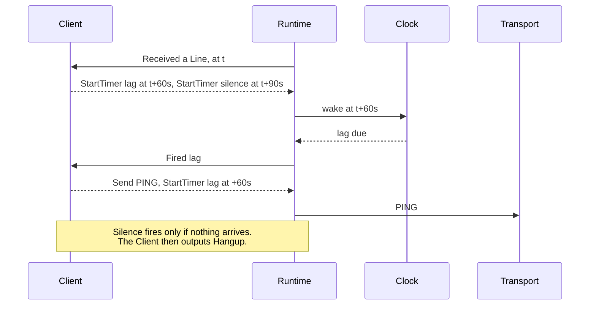

A timer's time is worked out from the `at` of the input that asked for it, never from the wall clock. So a replay asks for the same timers at the same times.

## 5. The Runtime and the Journal

Each input is recorded first, then stepped:

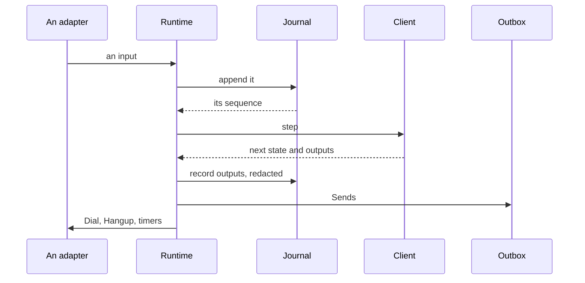

On a restart, replaying the Journal rebuilds everything:

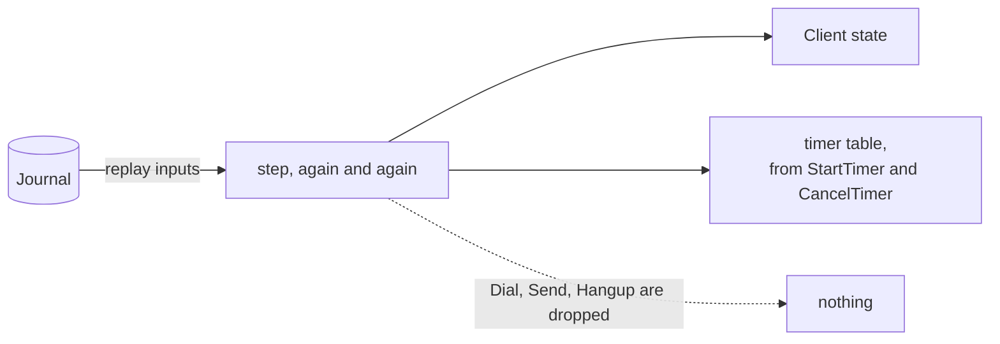

- **The timer table is a projection too.** It is rebuilt by replay and never stored, so no timer exists only in memory.
- **Outputs are recorded as what was done.** Views read them: without `echo-message`, the output that sent a Message is the only record that we said it. The Client's fold never reads them back.
- **A Connection open at a crash gets a `Closed` input** when the Runtime starts, as "the Daemon was killed" does now.
- **The Journal is versioned from the start, and nothing is frozen.** A Daemon that finds a Journal of another version refuses it, or starts a fresh one. We don't write migrations until the shape has settled.

## 6. XState, re-examined

Correctness and maintainability come before brevity, so XState deserves another look. Here is where each reason ADR 0003 gave for dropping it stands now.

| ADR 0003's reason | Where it stands in XState 5.33 |
| --- | --- |
| A timer couldn't be recorded before it applied | `transition(machine, snapshot, event)` returns `[next, actions]` and runs nothing. Delayed events come back as `xstate.raise` actions with a `delay` and an `id`, and `after` transitions as `xstate.after…` raises (see `packages/core/test/transition.test.ts`). The Runtime journals and schedules them. |
| Commands were named by function names that minification could take | Named actions from `setup()` come back as data, named by `type`. A lint or a test can ban inline actions. |
| It was an alpha with renames between releases | 5.33 is stable. v6 is the alpha: Rat Stack pins `6.0.0-alpha.71` with `@xstate/effect`. Start on v5 and watch v6. |
| Each step's cost grew with `after` and `enq.emit` | Not measured again yet. That is the spike's gate. |

**What XState gives:**

- **The right shape.** Hierarchy and parallel regions match IRC's: caps beside the nick offers, and the Session's regions.
- **Fewer impossible states.** A transition that can't happen is absent, rather than guarded against.
- **Model-based tests.** `xstate/graph` generates the shortest and the simple paths through a machine, so tests can reach every state. Transcripts supply the realism.
- **Diagrams from the code**, which can't drift from it.
- **Observability.** Snapshots serialise, and actors can be inspected.

**Where not to use it:** data. Members, modes, ISUPPORT, casemapping, and the table of Users are plain pure functions, called from `assign`. Parsing stays in `@iirc/protocol`. The Outbox's token bucket is arithmetic.

**Rat Stack runs the other way round.** It uses `@xstate/effect` so that a machine invokes Effects. In iirc's Client the machine never runs an Effect, and the Runtime carries out its actions. Rat Stack's pattern fits workflows in the shell, not the Client.

## 7. What changes

| Today | Proposed |
| --- | --- |
| A lifecycle machine, a Standing fold, and host loops with state of their own | Statecharts in the Client, and a Runtime with no IRC state |
| Three timer mechanisms | One: `StartTimer` and `CancelTimer`, through the Clock port |
| Four backoffs | One function, used by every machine |
| `Stage`, the lane gate, and the machine's `closing` | The Connection machine's states. The Transport reports `Closed` |
| `Deadline`, `Dropped`, and `closing` with `chosen` Entries | `Fired` and `Closed` inputs, and recorded outputs |
| Write acknowledgements, Pending, and a reconciler sending one Line at a time | Gone, because a Line counts as sent once emitted |
| Decisions made from `cause` strings | Typed intents |
| A Log format frozen during the soak | A versioned Journal, which can be rebuilt or thrown away until the shape settles |
| Per-Channel state spread across maps | One machine per Channel |
| Pacing constants shaped by ngircd | Pacing policy in the Outbox, set per Ircd |
| A read planner that re-reads `NAMES`, `MODE`, and `WHO` to stay certain | Features that make facts certain, and facts marked unknown without them |
| NickServ identify and a login wait | SASL during registration |
| ngircd as the everyday test Ircd | Transcripts in the everyday suite, and real Ircds in end-to-end runs |

## 8. Open questions and spikes

1. **XState spike.** Build Connection, Caps (with `cap-notify` and SASL), Presence, and Keepalive on v5's pure `transition`, with `multi-prefix` as the first Feature.
   - Measure replay cost over a Journal of a month's traffic, synthetic if need be.
   - Decide how Channel machines are held: spawned children, or a keyed map of child snapshots stepped with `transition`. The map is easier to replay purely.
2. **The Outbox.** Is priority part of the model, so inside the Client, or separate? How is pacing set per Ircd?
3. **Features.** How does a Feature declare its order in ingress, and its dependencies, such as `labeled-response` needing `batch`?
4. **Transcripts as fixtures.** Record real Sessions on Ergo, InspIRCd, Solanum, UnrealIRCd, and ngircd, so that no single Ircd shapes the tests.

Settled on 2026-11-08: the Journal holds inputs and outputs, versioned and not frozen. There is no soak in the short term. ADR 0001 is now "the RFC protocol is the floor". The record is called the Journal, and the glossary no longer uses Log.

## 9. How it is tested

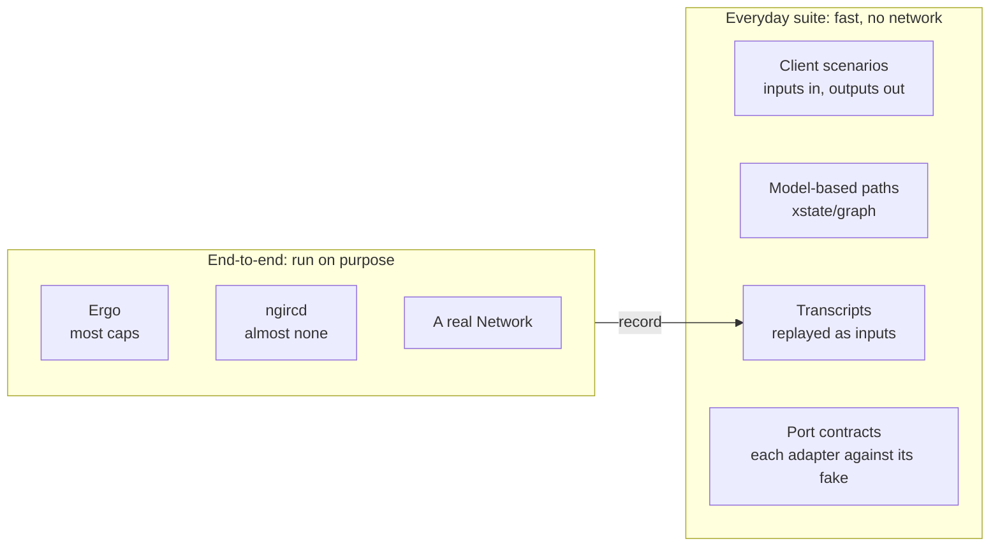

- **The everyday suite never opens a socket to an Ircd.** The Client is pure, so most of its tests are inputs in and outputs out, with `TestClock` for time.
- **Transcripts carry real Ircds into the fast suite.** An end-to-end run records what an Ircd sent, and that becomes a fixture.
- **End-to-end runs are deliberate,** such as before merging a milestone, or after a change to pacing. Ergo covers the first Features. ngircd covers the floor, on a private instance, never the shared one.

## 10. Features, not requirements

A central list of requirements, written ahead of time and split by theme, baked in assumptions before we had tested them. Instead, each module's README lists its **features**, built up from the module's floor by progressive enhancement:

- **The floor comes first.** For the Client, that is the RFC protocol (ADR 0001). For an adapter, it is the port's contract.
- **A feature is written down when it is built,** as scenarios at the module's interface. For the Client, a scenario is inputs in and outputs out. For an adapter, it is the port's contract tests.
- **A feature exists when its scenarios pass.** There are no status columns to keep in step with the code.

Each feature in a README has this shape:

```md
### Away status

- Needs: `away-notify`. Without it, away status is unknown, except from a `301`.
- Changes: what it adds to the model, and which Lines it reads or sends.
- Scenarios: `away.test.ts`
```

## 11. Getting started

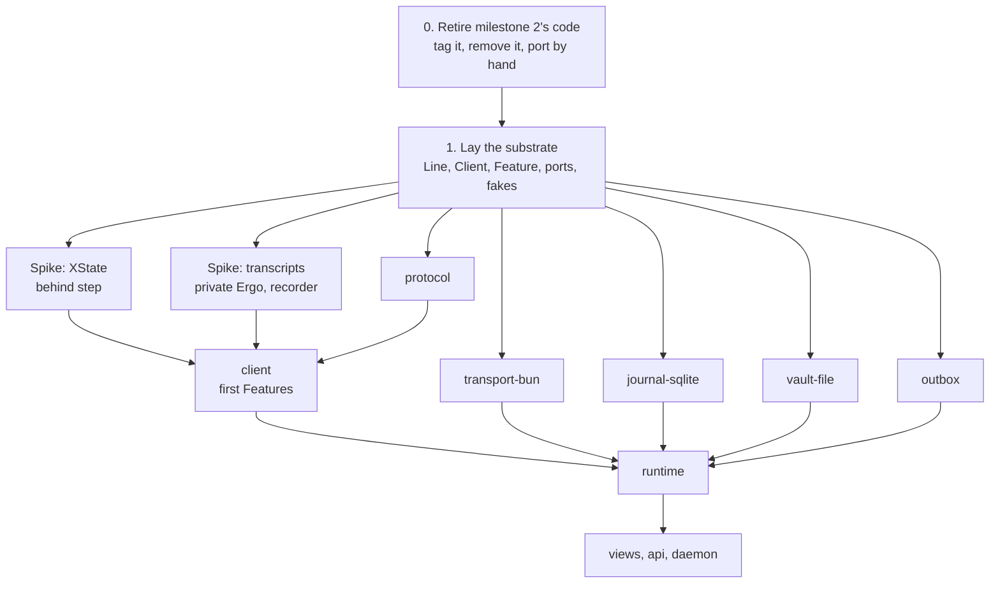

### 0. Retire milestone 2's code

- Done on 2026-11-08: `main` is tagged `m2`, and `apps/`, `packages/`, `packaging/`, and the running guide are gone from the tree.
- Salvage only by porting a file from the tag into a new module on purpose, with new tests at the new interface. Nothing imports old code, so nothing can be mistaken for an interface to stay compatible with.
- Worth porting: the Line grammar, parsing, building, and conformance vectors from `protocol`, plus casemapping and ISUPPORT parsing from `state`, CTCP, formatting, and framing.
- Not worth porting: `lifecycle`, `session`, `log`, and `daemon`. Their shape is what this proposal replaces.

### 1. Lay the interface substrate

The substrate is the set of interfaces that every module crosses. It is laid in the main session and reviewed, not delegated, because every brief depends on it.

| Seam | Interface | Its first two adapters |
| --- | --- | --- |
| Line | the Line type, parse and build | (a value, not a port) |
| Client | `initial`, `step`, `Input`, `Output` | the Client, and a scripted stand-in for testing the Runtime |
| Feature | requests, ingress, egress | `multi-prefix` and `message-tags` |
| Transport | dial, Lines both ways, how it ended | Bun TCP and TLS, and an in-memory pair |
| Journal | append, replay, follow | SQLite, and in memory |
| Vault | hold, and give at the last moment | file, and in memory |
| Clock | now, and wake at | Effect's `Clock` and `TestClock` |

- **Design it twice** for the Client and the Feature interfaces. Three subagents each design a radically different interface, and we compare them on depth, locality, and seam placement before choosing.
- **Each seam lands as types, a written interface, and a fake.** The written interface gives invariants, ordering, and error modes. Nothing in it has behaviour yet.
- **The workspace skeleton enforces the direction of dependencies** with a lint fence, as Rat Stack does.
- **Once accepted, the substrate changes only on purpose.** A module's brief may not change it. A builder that needs a change stops and says so.

### 2. Spikes

Each spike runs in its own worktree, and its code is thrown away or ported on purpose. Each ends in a note or an ADR.

- **XState** (§8.1), behind the substrate's `step`. It decides the Client's insides without touching its interface, and its result replaces ADR 0003.
- **Transcripts.** A private Ergo, a Transport that records, and a fixture format. Record Sessions with the first Features, and with none.

### 3. Modules from briefs

Once the substrate is in place, modules that only meet at it can be built in parallel by subagents. Each brief gives:

- the module's role, and the substrate interfaces it implements or uses, which it may read but not change
- its features, floor first
- what done means: tests at its interface, contract tests for a port, `check` and `knip` clean
- what it must not do: change the substrate, import an adapter into the core, or import milestone 2's code

`protocol`, `transport-bun`, `journal-sqlite`, `vault-file`, and `outbox` can start as soon as the substrate is accepted. `client` waits for the XState spike and the transcripts. `runtime` waits for `client`. `views`, `api`, and `daemon` come last.
